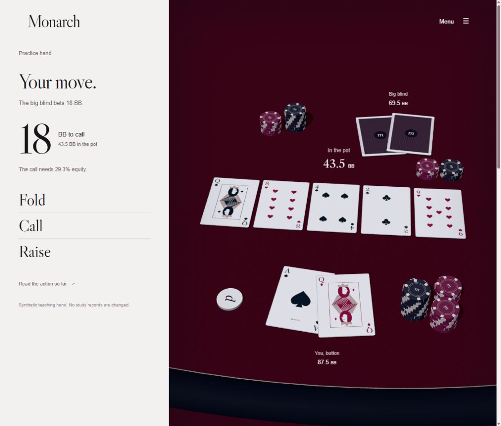

# Monarch

A local poker study application for six-max No-Limit Hold'em, built with React, TypeScript, Express and SQLite. Import hand histories, replay decisions at a cinematic 3D table, practise ranges and pot odds, and explore card frequencies.



Monarch keeps hands, notes, ranges and study records on your own computer. The repository includes synthetic examples; personal histories and databases are excluded.

## Start

Double-click **Start Monarch.cmd**. It opens the app at http://127.0.0.1:4317. Use **Stop Monarch.cmd** to stop the server and folder watcher. Closing the browser tab leaves the server running.

Node.js 22.13 or later must be on PATH. The launcher installs dependencies with `npm ci` and creates a production build on first use. That installation needs internet access. Poker study works offline; optional Spotify playback needs a connection and Spotify Premium. Node 22 may print an experimental SQLite warning.

The personal library starts empty. The Study page opens with a synthetic hand that is excluded from statistics. Draw, pot-odds and range exercises work without imported hands.

## Motion

Study opens with the approved table sequence and stops at the river decision. The full-screen Menu opens every part of the app. Your record sits below the opening sequence.

Settings controls camera motion and automatic practice playback. Reduced motion goes directly to the practice decision. Menus, leaving the tab and scrolling away pause playback. Replay controls remain available for stepping through imported hands.

Choose an action to finish a frozen review. Optional reasoning can be entered first. The recorded hand continues automatically when motion and automatic playback are enabled. Practice exercises wait on their answer and feedback screens.

## Import histories

Export cash-game hand histories from GGPoker PokerCraft. In **Import histories**, select TXT or ZIP files, select a folder, or enter a folder path. You can also put files in the watched `data/Inbox` folder. Change its location in Settings.

The watcher checks every eight seconds. A file must have an unchanged size and modification time across two scans before import. Monarch copies source bytes to `data/Imported` before inserting hands. It leaves the source file in place. Duplicate hand IDs do not create additional hands. Rejected hands appear in the import report with their source text and reason.

The parser supports common English GG cash-history exports with two through six players. It reads UTF-8 and UTF-16 with a byte-order mark. Imports are limited to 30 MB and 2,000 ZIP entries. Tournaments, multiple boards, cashout, insurance, straddles, bomb pots and unsupported actions are reported for inspection.

## Study

- **Reviews** opens a flagged decision with later actions, cards and earlier notes hidden. Choose an action and record your reasoning before revealing the result. Completing a review awards XP once.
- **Hands** filters the imported library and opens the replay. The replay tracks stacks, bets, pot, current hand strength and available draw completions. Decision freeze stops before your next action.
- **Card frequencies** counts the 169 starting-hand classes and each of the 52 cards in your imported records. Filter by date, position or session. Hole cards, flops, turns and rivers have separate eligible-hand counts; later streets count only their newly dealt card. Select a cell to inspect the matching records. Starting hands include a combinatorial random-deal reference, not a prediction.
- **Sessions** shows opportunity-based statistics, position splits and session results. Histories retain their original wall-clock timestamps. Sessions group the same table, hero and stakes until a gap exceeds 45 minutes.
- **Ranges** edits the 169 hand classes by position and situation. Changes save locally. Practice uses a snapshot of the range when the exercise starts. Mixed and unconfigured cells are not graded.
- **Practice** covers straight-draw recognition, pot odds, turn completion probability and saved preflop ranges. The server grades each answer and awards XP once.
- **River calls** shows river investment, showdown payouts, whole-hand results and tagged calls. Review flags identify hands to inspect. They do not prove that an action was a mistake.
- **Opponents** shows session-specific identities, sample sizes, observed actions and notes. Fewer than 30 hands remains Unknown. Matching aliases combine only when you choose that option. The list contains the 250 most recent session identities.

The editable range baseline assumes 100 BB. It is a study starting point. Raise size, stack depth and opponent behaviour can change a decision. Monarch does not contain a solver or an equity-versus-range calculator. Draw completion probability is not winning equity. Pot odds exclude side-pot chips the caller cannot win and are calculated before future rake.

## Back up data

Stop Monarch, then copy the entire `data` folder. Copying only an open SQLite file can omit changes in its write-ahead log.

```text
data/
  monarch.sqlite
  Inbox/
  Imported/
  server.log
  server-error.log
```

Settings can export original hand histories as TXT. That export does not include notes, ranges or progress. Recalculate rebuilds derived statistics and pending review flags while preserving notes and completed reviews.

The server binds to `127.0.0.1`. It checks Host and Origin and requires an application header for writes. Fonts are stored locally. No account is required.

## Development

```powershell
npm ci
npm run dev
npm run check
npm run test:exhaustive
npm start
```

Use `PORT` and `MONARCH_DATA` for an isolated development instance. The launcher uses its own `data` folder and port 4317.

Poker mechanics live in `src/poker`, imports in `src/import`, statistics in `src/analysis`, exercises in `src/training`, screens in `src/ui`, and persistence and HTTP endpoints in `server`. Money uses integer cents. Hand evaluation compares five-card subsets. Straight detection checks all ten legal sequences with Ace high or low.

`DESIGN.md` records the typography, colour, spacing, composition and motion rules. Libre Caslon Display and its licence are in `public/study-film`. The original card artwork, table renderer and Three.js licence are stored there too.

This is a local browser application with a Windows launcher. It is not a signed installer. The hand list is paginated, but imports and recalculation currently run synchronously. A 100,000-hand library has not been benchmarked. Compatibility has been tested with synthetic histories, not a personal PokerCraft export.

## Music and effects

Open **Sound** for Spotify Premium playback of the Ocean's Eleven, Twelve and Thirteen soundtracks. Music stays independent of the hand sequence. Card, chip and interface effects have a separate level. Connection and implementation notes are in [SOUND.md](SOUND.md).
